<picture>
  <source media="(prefers-color-scheme: dark)" srcset="dark.svg">
  <source media="(prefers-color-scheme: light)" srcset="light.svg">
  
</picture>

<h1 align="center">Hey, I'm Foxvyn 👋</h1>

  <strong>Building ideas into intelligent solutions.</strong> 
  Software Engineering · AI · Cybersecurity · Full-Stack Development

## About

I'm an Information Technology undergraduate at President University interested in building practical software, exploring AI-driven solutions, and understanding how systems can be made more secure. I enjoy taking ideas from problem definition through implementation and refinement.

## Featured Projects

### Tinjob
An AI-assisted career platform concept that brings together CV scoring, aptitude assessments, skill-gap guidance, and job recommendations.

### AI-Assisted Cybersecurity Risk Assessment & Security Audit Platform
A platform concept focused on supporting cybersecurity risk evaluation and security-audit workflows with AI-assisted analysis.

### Malware Detection Application
An application project exploring hash-based malware detection and real-time detection logic.

### The Kondangans
A B2B catering marketplace concept designed to connect businesses with catering providers and support the ordering workflow.

> Project descriptions are summarized here. Add links to the corresponding public repositories or demos when they are available.

## Tech Stack & Tools

**Languages and development:** Python · JavaScript · C++ · Java · Kotlin · React · Tailwind CSS  
**Platforms and tools:** Supabase · Git · Linux · Wireshark · Autopsy

*This list reflects technologies and tools used across projects and coursework, not a claim of equal proficiency in every item.*

## Current Focus

- Building maintainable full-stack applications.
- Exploring practical AI integrations.
- Learning cybersecurity, risk assessment, and digital forensics.

## Activity

GitHub contribution activity is available on my profile. Automated metrics and achievement panels can be added after configuring their respective GitHub Actions workflows, keeping this README free of fabricated statistics.

## GitHub Activity

## Connect

- GitHub: [@foxvyn](https://github.com/foxvyn)

---

Learn continuously. Build thoughtfully. Improve relentlessly.

