<picture>
  <source media="(prefers-color-scheme: dark)" srcset="dark.svg">
  <source media="(prefers-color-scheme: light)" srcset="light.svg">
  
</picture>

# Hey, I'm Foxvyn 👋

**Building ideas into intelligent solutions.**

Software Engineering · AI · Cybersecurity · Full-Stack Development

---

## `$ whoami`

I'm an Information Technology undergraduate who enjoys turning ideas into useful software. I work across full-stack development, explore practical AI applications, and keep learning how to build and assess more secure systems.

I like working through the full process: understanding a problem, shaping the solution, building it, and improving the details that make it reliable and easier to use.

<strong>More about how I work</strong>

 

- **Build with purpose:** focus on solving a real problem rather than adding technology for its own sake.
- **Explore across disciplines:** connect software engineering, AI, and cybersecurity.
- **Keep improving:** learn by experimenting, building projects, and refining what already exists.

## Current Focus

<table>
  <tr>
    <td width="50%">
      <strong>⌘ Software Engineering</strong> 
      Building full-stack applications, improving application structure, and creating practical user experiences.
    </td>
    <td width="50%">
      <strong>✳ Applied AI</strong> 
      Exploring AI-assisted features, intelligent workflows, and ways to make applications more useful.
    </td>
  </tr>
  <tr>
    <td width="50%">
      <strong>⬡ Cybersecurity</strong> 
      Developing knowledge in secure application design, security assessment, and digital investigation.
    </td>
    <td width="50%">
      <strong>↗ Continuous Building</strong> 
      Turning concepts into working projects and learning through implementation.
    </td>
  </tr>
</table>

## Tech Stack

*Technologies I work with across projects. This is a manually maintained list, not a ranking of proficiency.*

**Programming Languages**

  
  
  
  
  
  
  
  

**Frontend & Backend**

  
  
  
  
  
  
  

**Databases & Services**

  
  
  

**Tools & Platforms**

  
  
  
  
  
  

## Other Interests

<table>
  <tr>
    <td width="50%" valign="top">
      <h3>🛡️ Cybersecurity</h3>
      
Interested in understanding how systems fail, how threats behave, and how applications can be made more resilient.

      <ul>
        <li>Application & network security</li>
        <li>Security risk assessment</li>
        <li>Digital forensics</li>
        <li>Malware analysis and detection</li>
      </ul>
    </td>
    <td width="50%" valign="top">
      <h3>✳ AI Enthusiasm</h3>
      
Curious about applying AI to real workflows and building tools that help people make better use of information.

      <ul>
        <li>AI-assisted applications</li>
        <li>Intelligent automation</li>
        <li>AI for developer productivity</li>
        <li>Practical AI experimentation</li>
      </ul>
    </td>
  </tr>
</table>

## Featured Projects

*A selection of projects across software engineering, AI, and cybersecurity.*

### 01 · Tinjob
**AI-assisted career and skill development platform**

A platform concept that brings CV evaluation, aptitude assessments, skill-gap guidance, and job matching into one connected experience.

`Python` `JavaScript` `React` `Tailwind CSS`

### 02 · AI-Assisted Cybersecurity Risk Assessment & Security Audit Platform
**AI-supported security assessment workflow**

A platform designed to support risk evaluation and security-audit activities, helping organize assessment inputs and turn findings into more actionable insights.

`Python` `React` `Tailwind CSS` `AI`

### 03 · Malware Detection Application
**Exploring malware detection on mobile and desktop technologies**

An application project exploring hash-based file identification and real-time malware detection concepts.

`C++` `Java` `Kotlin` `Android`

### 04 · The Kondangans
**B2B catering marketplace for businesses and catering providers**

A marketplace concept focused on simplifying catering discovery and ordering between business customers and catering providers.

`Supabase` `JavaScript` `Groq`

### 05 · Digital Forensics & Network Analysis
**Hands-on investigation and network traffic analysis**

Coursework-based practical work exploring digital evidence examination and network traffic inspection using forensic and packet-analysis tools.

`Autopsy` `Wireshark` `Linux`

> Project descriptions summarize the known scope. Repository and demo links can be added once the corresponding public URLs are confirmed.

## GitHub Activity

  

## Connect

**Have an idea, project, or interesting technical problem? Let's connect.**

---

  Build with purpose · Stay curious · Keep improving

