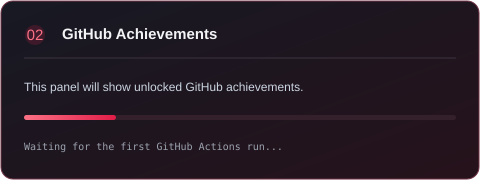

<picture>
  <source media="(prefers-color-scheme: dark)" srcset="./dark.svg">
  <source media="(prefers-color-scheme: light)" srcset="./light.svg">
  
</picture>

### Software Engineering · AI Enthusiast · Cybersecurity

*Building ideas into intelligent solutions.*

---

## `$ whoami`

Hi, I'm **Tio Muhammad Rizky**, known on GitHub as **Foxvyn**.

I'm an Information Technology undergraduate interested in building useful software, exploring practical AI, and understanding how digital systems can be made more secure. I enjoy connecting the dots between an idea, its user experience, the engineering behind it, and the details that make it reliable.

I learn by building: exploring a problem, designing a solution, implementing it, testing the result, and improving what can be better.

<strong>How I approach building</strong>

- **Purpose first** — understand the problem before choosing the tools.
- **Think end-to-end** — consider usability, functionality, and security together.
- **Stay curious** — experiment with new ideas and learn from implementation.
- **Improve continuously** — refine code, workflows, and the final experience.

## Current Focus

<table>
  <tr>
    <td width="50%" valign="top">

**⌘ Software Engineering**

Developing practical applications, improving application structure, and building reliable features across the stack.

</td>
    <td width="50%" valign="top">

**✳ Applied AI**

Exploring AI-assisted features, intelligent workflows, and useful ways to bring AI into applications.

</td>
  </tr>
  <tr>
    <td width="50%" valign="top">

**⬡ Cybersecurity**

Learning about secure application design, security assessment, digital investigation, and threat detection.

</td>
    <td width="50%" valign="top">

**↗ Full-Stack Development**

Connecting frontend experiences, backend services, and data layers into cohesive applications.

</td>
  </tr>
</table>

## Tech Stack

Technologies and tools I use or explore. This is a manually maintained list, not a proficiency ranking.

**Programming Languages**

  
  
  
  
  
  
  
  

**Frontend & Backend**

  
  
  
  
  
  
  

**Databases & Services**

  
  
  

**Tools & Platforms**

  
  
  
  
  
  

## Other Interests

<table>
  <tr>
    <td width="50%" valign="top">

### 🛡️ Cybersecurity

Interested in understanding how systems fail, how threats behave, and how applications can be made more resilient.

- Application and network security
- Security risk assessment
- Digital forensics
- Malware analysis and detection

</td>
    <td width="50%" valign="top">

### ✳ AI Enthusiast

Curious about applying AI to real workflows and building tools that help people make better use of information.

- AI-assisted applications
- Intelligent automation
- AI for developer productivity
- Practical AI experimentation

</td>
  </tr>
</table>

## Featured Projects

*A curated look at projects and practical explorations across software engineering, AI, and cybersecurity.*

<table>
  <tr>
    <td width="50%" valign="top">

### 01 · Tinjob

**AI-assisted career and skill development platform**

A platform concept connecting CV evaluation, aptitude assessments, skill-gap guidance, and job matching in one experience.

`Python` `JavaScript` `React` `Tailwind CSS`

</td>
    <td width="50%" valign="top">

### 02 · AI Cybersecurity Risk Assessment

**AI-supported security assessment workflow**

A platform concept for organizing risk-assessment inputs and supporting security-audit activities with more actionable insights.

`Python` `React` `Tailwind CSS` `AI`

</td>
  </tr>
  <tr>
    <td width="50%" valign="top">

### 03 · Malware Detection Application

**Malware detection exploration**

An application project exploring hash-based file identification and real-time malware-detection concepts across mobile and desktop technologies.

`C++` `Java` `Kotlin` `Android`

</td>
    <td width="50%" valign="top">

### 04 · The Kondangans

**B2B catering marketplace**

A marketplace concept focused on simplifying catering discovery and ordering between business customers and catering providers.

`Supabase` `JavaScript` `Groq`

</td>
  </tr>
  <tr>
    <td colspan="2" valign="top">

### 05 · Digital Forensics & Network Analysis

**Practical investigation and traffic analysis**

Coursework-based practical exploration of digital-evidence examination and network-traffic inspection using forensic and packet-analysis tools.

`Autopsy` `Wireshark` `Linux`

</td>
  </tr>
</table>

Project summaries reflect the information currently available in this profile repository. Repository links are intentionally omitted until the exact public URLs are confirmed.

## GitHub Insights

Automatically refreshed by GitHub Actions. Language activity, achievements, and contribution activity are separated to keep each panel readable.

<table>
  <tr>
    <td width="50%" valign="top" align="center">

**Most-used Languages**

</td>
    <td width="50%" valign="top" align="center">

**GitHub Achievements**

</td>
  </tr>
</table>

**Contribution Activity**

## Let's Connect

I'm always interested in learning, building, and collaborating on meaningful technical ideas.

**Have an interesting problem or an idea worth building? Let's connect.**

---

  Build with purpose · Stay curious · Keep improving

